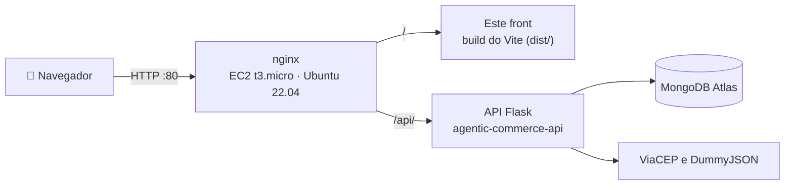

<div align="center">

# 🛒 Agentic Commerce · Web

**O front-end React do Agentic Commerce: compra de supermercado por intenção, com autonomia controlada.**

Você diz o que precisa. O agente busca, compara e explica;<br>
você define os limites e aprova o que importa.

[](http://54.209.228.101)
[](http://54.209.228.101)


**[🌐 Aplicação](http://54.209.228.101)** ·
**[🧠 API (agentic-commerce-api)](https://github.com/iajuss/agentic-commerce-api)** ·
**[🎨 Identidade visual](docs/identidade-visual.md)** ·
**[🔗 Guia de integração](docs/integracao-backend.md)**

</div>

---

## 📑 Sumário

- [🌐 Produção](#-produção)
- [👥 Equipe](#-equipe)
- [✨ Funcionalidades](#-funcionalidades)
- [🧭 Telas e rotas da API](#-telas-e-rotas-da-api)
- [🧱 Arquitetura](#-arquitetura)
- [🎯 Requisitos da disciplina](#-requisitos-da-disciplina)
- [🧰 Tecnologias](#-tecnologias)
- [💻 Como rodar localmente](#-como-rodar-localmente)
- [🔐 Variáveis de ambiente](#-variáveis-de-ambiente)
- [📜 Comandos](#-comandos)
- [🔑 Sessão e autenticação](#-sessão-e-autenticação)
- [🎨 Identidade visual e acessibilidade](#-identidade-visual-e-acessibilidade)
- [🚀 Deploy na EC2](#-deploy-na-ec2)
- [🚧 Limitações do MVP](#-limitações-do-mvp)
- [📁 Estrutura do projeto](#-estrutura-do-projeto)
- [📚 Documentação](#-documentação)
- [🤝 Como contribuir](#-como-contribuir)

## 🌐 Produção

O build do React está no ar em **<http://54.209.228.101>**, servido pelo nginx numa **AWS EC2** (t3.micro, Ubuntu
22.04 LTS). O mesmo nginx encaminha `/api/` para a API Flask
([`agentic-commerce-api`](https://github.com/iajuss/agentic-commerce-api)), então o React chama a API no mesmo
endereço, sem CORS.

| O quê | Endereço |
|---|---|
| 🌐 Aplicação | <http://54.209.228.101> |
| 🔑 Entrar e criar conta | <http://54.209.228.101/entrar> · <http://54.209.228.101/cadastro> |
| 🩺 Saúde da API | <http://54.209.228.101/api/health> |
| 🧠 Repositório da API | <https://github.com/iajuss/agentic-commerce-api> |

> [!WARNING]
> O site é HTTP, sem TLS, e o banco é compartilhado. Crie a conta com um e-mail de teste e **não use uma senha real**.

### Roteiro rápido para testar

1. Em **Criar conta**, cadastre-se com um e-mail de teste (senha de 8 a 128 caracteres).
2. Em **Políticas**, crie uma regra: por exemplo, teto de R$ 300, categorias "Alimentos e Bebidas" e "Casa e Limpeza" e
   autonomia **Manual**.
3. Em **Nova compra**, escreva `arroz 5kg, 2 leites integrais e detergente`.
4. Na cesta, veja por que cada oferta foi escolhida, as alternativas (inclusive as da DummyJSON) e o que ficou fora da
   política.
5. Clique em **Aprovar compra de R$ …**, confirme com a senha e depois em **Gerar Pix de R$ …**.
6. No pedido, use **Simular pagamento**: o envio e a entrega avançam sozinhos em poucos minutos.
7. Em **Perfil**, informe um CEP (ex.: `01001-000`) e veja o endereço completado pelo ViaCEP.
8. Em **Auditoria**, confira a trilha de cada passo: até uma senha digitada errado na aprovação fica registrada.

> [!TIP]
> Para ver a compra automática, crie uma política com autonomia **Automática** e um teto acima do total da cesta: o
> agente compra sozinho, sem pedir a senha, e já gera o Pix.

## 👥 Equipe

Projeto da disciplina **Programação Eficaz**, apresentado em 03/11/2026.

<table>
  <tr>
    <td align="center" width="20%">
      <a href="https://github.com/TucaAR15"><br><b>Arthur Azevedo</b></a><br><sub>@TucaAR15</sub>
    </td>
    <td align="center" width="20%">
      <a href="https://github.com/iajuss"><br><b>Davi Damazio</b></a><br><sub>@iajuss</sub>
    </td>
    <td align="center" width="20%">
      <a href="https://github.com/lucascruzfinance"><br><b>Lucas Cruz</b></a><br><sub>@lucascruzfinance</sub>
    </td>
    <td align="center" width="20%">
      <a href="https://github.com/Lucas-Ibanez"><br><b>Lucas Ibanez</b></a><br><sub>@Lucas-Ibanez</sub>
    </td>
    <td align="center" width="20%">
      <a href="https://github.com/RFontes13RF"><br><b>Ryan Fontes</b></a><br><sub>@RFontes13RF</sub>
    </td>
  </tr>
</table>

## ✨ Funcionalidades

- 🔐 **Conta e sessão:** cadastro, login com JWT, rotas privadas e logout; a sessão termina junto com o token.
- 🛡️ **Políticas de compra:** teto por compra, categorias, lojas e autonomia (manual ou automática), com sugestões das
  categorias do catálogo.
- 📝 **Nova compra:** a lista em texto livre, como você escreveria num papel, e o histórico das listas anteriores.
- 🏆 **Cesta explicada:** uma oferta recomendada por item, até 4 alternativas, o motivo em frases com números e o que
  ficou fora da política.
- ✅ **Aprovação com senha:** o modal mostra valor, loja e validade antes do botão; a senha errada não encerra a sessão.
- ⚡ **Compra automática:** quando a cesta cabe numa política automática, o agente compra sozinho e já gera o Pix.
- 🔑 **Autorizações:** as autorizações limitadas ativas, com a validade, a geração do Pix e a revogação.
- 💸 **Pedidos e Pix simulado:** código copia e cola, simulação do pagamento, comprovante e acompanhamento do envio e da
  entrega.
- ↩️ **Pós-compra:** cancelamento, devolução em até 7 dias depois da entrega e chamados de suporte.
- 👤 **Perfil:** nome, data de nascimento, marcas preferidas e evitadas, orçamento mensal e endereço completado pelo CEP.
- 📜 **Auditoria:** a trilha de cada decisão, sua e do agente, paginada.
- 📱 **Responsivo e acessível:** menu lateral recolhível (no celular, vira uma barra inferior), modo escuro automático,
  foco sempre visível e status com ícone e texto, nunca só com cor.

## 🧭 Telas e rotas da API

As 11 telas usam as **27 rotas** da API. Toda tela, menos `/entrar` e `/cadastro`, exige login.

| Tela | O que faz | Rotas da API usadas |
|---|---|---|
| `/entrar` | Login; avisa antes se a API ou o banco estiverem fora do ar | `POST /sessoes`, `GET /health` |
| `/cadastro` | Cria a conta e já entra | `POST /usuarios`, `POST /sessoes` |
| `/inicio` | Visão geral da jornada e da política principal | `GET /politicas` |
| `/compras/nova` | Lista de compras em texto livre e histórico | `POST /solicitacoes`, `GET /solicitacoes` |
| `/compras/{id}` | Cesta explicada, alternativas, cancelamento, aprovação com senha e geração do Pix | `GET /solicitacoes/{id}`, `DELETE /solicitacoes/{id}`, `GET /politicas`, `POST /solicitacoes/{id}/autorizacoes`, `GET /autorizacoes/{id}`, `POST /pedidos` |
| `/politicas` | Cria, edita, ativa e remove políticas | `GET /politicas`, `POST /politicas`, `GET /politicas/{id}`, `PUT /politicas/{id}`, `DELETE /politicas/{id}` |
| `/perfil` | Dados, preferências, orçamento e endereço pelo CEP | `GET /usuarios/me`, `PATCH /usuarios/me` |
| `/autorizacoes` | Autorizações ativas, geração do Pix e revogação | `GET /autorizacoes`, `DELETE /autorizacoes/{id}`, `POST /pedidos` |
| `/pedidos` | Lista dos pedidos | `GET /pedidos` |
| `/pedidos/{id}` | Pix simulado, comprovante, acompanhamento, cancelamento, devolução e chamados | `GET /pedidos/{id}`, `PATCH /pedidos/{id}`, `POST /simulador-pix/pagamentos`, `GET /pedidos/{id}/chamados`, `POST /pedidos/{id}/chamados`, `GET /pedidos/{id}/chamados/{chamado_id}` |
| `/auditoria` | Trilha de decisões, paginada | `GET /auditoria` |

## 🧱 Arquitetura



- **O React só fala com a API Flask**, nunca com o banco nem com APIs externas.
- `src/pages/`: uma tela por arquivo, registrada no React Router em `src/App.tsx`.
- `src/api/`: uma função por rota da API, com os tipos TypeScript das respostas. O `client.ts` faz o `fetch`, envia o
  `Authorization: Bearer` e transforma o erro `{"erro", "detalhes"}` da API num `ApiError`.
- `src/contexts/AuthContext.tsx`: a sessão (usuário e token), com `login`, `register` e `logout`.
- `src/components/`: peças reutilizáveis, como o menu (`AppLayout`), o modal de aprovação (`ApprovalDialog`), o card de
  oferta (`OfferCard`) e os selos de status (`StatusBadge`).
- `src/styles/`: `tokens.css` → `components.css` → `global.css`, importados nessa ordem em `src/main.tsx`.

## 🎯 Requisitos da disciplina

| Conceito | Critério | Onde conferir |
|---|---|---|
| **C+** | Cada rota da API usada por alguma tela do React | [Telas e rotas da API](#-telas-e-rotas-da-api): as 27 rotas |
| **A** | Login, logout e rotas privadas no React | `AuthContext`, `ProtectedRoute` e o botão **Sair** |
| **A+** | Build do React servido pelo nginx na EC2, com o link no README do front | <http://54.209.228.101> |

Os demais critérios (API na EC2, pytest, JWT no Flask e Atlas) estão no
[README da API](https://github.com/iajuss/agentic-commerce-api#-requisitos-da-disciplina).

## 🧰 Tecnologias

| Camada | Tecnologia |
|---|---|
| ⚛️ Interface | React 19.3 e React Router 7.18 |
| ⚡ Build | Vite 8.3 com `@vitejs/plugin-react` |
| 🔷 Linguagem | TypeScript 6.0 em modo `strict` |
| 🎨 Estilo | CSS puro com tokens, sem Tailwind nem biblioteca de componentes; fontes Manrope e DM Sans |
| 🖼️ Ícones | lucide-react |
| 🧹 Qualidade | ESLint 9 com typescript-eslint e as regras da identidade visual (`scripts/check-design-tokens.mjs`) |
| 📦 Pacotes | pnpm 11, com versões exatas no `package.json` |
| 🚀 Hospedagem | nginx numa AWS EC2, publicado pelo `deploy/publicar-front.sh` da API |

## 💻 Como rodar localmente

**Pré-requisitos:** Node.js 20.19+ ou 22.12+ (exigência do Vite 8) e pnpm 11 (`corepack enable` instala a versão do
`packageManager`).

```bash
git clone https://github.com/iajuss/agentic-commerce-web.git
cd agentic-commerce-web
pnpm install
copy .env.example .env      # Windows (Linux/macOS: cp .env.example .env)
pnpm dev                    # http://localhost:5173
```

Escolha no `.env` qual API o front vai usar:

| Modo | No `.env` | Quando usar |
|---|---|---|
| 💻 API local | `VITE_API_URL=http://localhost:5000` (padrão) | Com o [`agentic-commerce-api`](https://github.com/iajuss/agentic-commerce-api#-como-rodar-localmente) rodando na sua máquina |
| ☁️ API de produção | `VITE_API_URL=http://54.209.228.101/api` | Para mexer só no front, sem rodar o backend: o CORS da produção libera `http://localhost:5173` |
| 🎭 Demonstração | `VITE_USE_MOCK_API=true` | Para navegar sem API: o login aceita qualquer e-mail e senha, e nada é salvo |

> [!NOTE]
> No modo de demonstração, os dados ficam só na memória da aba (recarregar volta ao início) e a senha `senhaerrada`
> simula a senha incorreta na aprovação. Esse modo só vale no `pnpm dev`, nunca no build de produção.

## 🔐 Variáveis de ambiente

| Variável | Padrão | Para quê |
|---|---|---|
| `VITE_API_URL` | `http://localhost:5000` | Endereço base da API Flask. O build de produção lê o `.env.production` versionado: `/api` |
| `VITE_USE_MOCK_API` | `false` | `true` liga o modo de demonstração, só no `pnpm dev` |

- Na EC2, o nginx serve o front e encaminha `/api` para a API, por isso o `.env.production` usa um caminho relativo.
- As variáveis `VITE_*` entram no JavaScript entregue ao navegador: **nunca coloque segredos nelas**. O `.env` local
  fica fora do Git.

> [!CAUTION]
> Não passe `VITE_API_URL=/api` na linha de comando do Git Bash: o MSYS converte o valor em `C:/Program Files/Git/api`
> e nenhuma chamada funciona. Uma `VITE_API_URL` definida no ambiente também vence o `.env.production`.

## 📜 Comandos

| Comando | O que faz |
|---|---|
| `pnpm dev` | Servidor de desenvolvimento em `http://localhost:5173` |
| `pnpm build` | Confere os tipos (`tsc -b`) e gera o build de produção em `dist/` |
| `pnpm lint` | ESLint e as regras automáticas da identidade visual |
| `pnpm preview` | Serve localmente o build de `dist/` |

## 🔑 Sessão e autenticação

- O login (`POST /sessoes`) devolve um JWT, guardado no `localStorage` e enviado em `Authorization: Bearer` pelo
  `src/api/client.ts`.
- O cadastro (`POST /usuarios`) faz o login logo em seguida.
- As telas internas ficam atrás do `<ProtectedRoute>`: sem sessão, a pessoa vai para `/entrar` e, depois do login,
  volta para a página que tentou abrir.
- A sessão termina quando o token vence (o front lê o `exp` do JWT) ou quando a API responde `401` a uma requisição com
  token. A exceção é a senha errada na aprovação (`401` com `detalhes.senha`): a pessoa continua logada e tenta de novo.
- Os erros da API chegam como `ApiError`: a mensagem (`erro`) aparece no topo do formulário, e cada item de `detalhes`,
  embaixo do campo com o mesmo nome.
- **Sair** apaga o token e os dados da sessão do navegador.

## 🎨 Identidade visual e acessibilidade

> O agente é uma lupa na mão do usuário, não um robô que decide por ele.

A interface parece um documento organizado: papel claro, tinta escura, verde-floresta para confiança e ação, e o lima
como marca-texto, só onde o agente aponta algo. Três palavras guiam as decisões: **Clareza**, **Controle** e **Calma**.

- 🎨 Cores, fontes e medidas só por variáveis de `src/styles/tokens.css`; componentes reaproveitados de
  `src/styles/components.css` (`.btn`, `.field`, `.card`, `.panel`, `.badge`...).
- 🏷️ Status sempre pelo `<StatusBadge>` (cor, ícone e texto juntos), logo pelo `<Brand>` e ícones do `lucide-react`.
- ♿ Foco sempre visível, um `<h1>` por tela, texto com no mínimo 12px, alvos de toque de 44px e animações que respeitam
  `prefers-reduced-motion`.
- 🌙 Modo escuro automático, seguindo o sistema; toda tela é conferida no celular (375px), no teclado e no escuro.
- 💬 Textos em português do Brasil, falando com "você", e valores no formato brasileiro (R$ 389,90 · 30/out · 14:03).
- 🧹 O `pnpm lint` reprova cor fixa, fonte fixa, texto menor que 12px e caractere usado como ícone.

Antes de criar ou alterar uma tela, leia [`docs/identidade-visual.md`](docs/identidade-visual.md): cores, tipografia,
componentes, ícones e tom de voz são obrigatórios. As regras gerais do projeto estão em [`AGENTS.md`](AGENTS.md).

## 🚀 Deploy na EC2

O build é publicado na mesma EC2 da API, pelo script `deploy/publicar-front.sh` do
[`agentic-commerce-api`](https://github.com/iajuss/agentic-commerce-api#publicar-o-front). Rode no Git Bash (ou no
Linux), na pasta deste repositório:

```bash
git pull --ff-only
pnpm install --frozen-lockfile
pnpm lint && pnpm build              # o build lê o .env.production (VITE_API_URL=/api)
tar -C dist -czf /tmp/front.tar.gz .
scp -i CHAVE.pem /tmp/front.tar.gz ubuntu@IP_PUBLICO_DA_EC2:/tmp/front.tar.gz
ssh -i CHAVE.pem ubuntu@IP_PUBLICO_DA_EC2 \
    "bash /opt/agentic-commerce-api/deploy/publicar-front.sh /tmp/front.tar.gz $(git rev-parse --short HEAD) && rm /tmp/front.tar.gz"
```

- 🗂️ **Versões e troca atômica:** cada build vira uma pasta em `/var/www/agentic-commerce-web/versoes/`, com a data e o
  commit. O nginx serve o link `atual`, que só muda depois de o script conferir o pacote, de uma vez e sem reiniciar o
  nginx.
- ↩️ **Retorno:** se o nginx não servir a versão nova, o link volta sozinho para a anterior. Para desfazer uma
  publicação, rode `bash /opt/agentic-commerce-api/deploy/publicar-front.sh --voltar` na instância. As 5 versões mais
  recentes ficam guardadas.
- 🧭 **Rotas do React:** qualquer caminho que não seja arquivo (`/perfil`, `/pedidos/{id}`...) recebe o `index.html`.
- 🗃️ **Cache:** os arquivos de `/assets/`, com o hash no nome, ficam um ano no navegador; o `index.html` é conferido a
  cada visita, então uma publicação nova aparece no próximo carregamento.
- 🛡️ **Segurança:** gzip e cabeçalhos de segurança no nginx, com uma CSP que só libera o próprio site, o Google Fonts e
  as imagens da DummyJSON.

## 🚧 Limitações do MVP

- 🔓 **HTTP sem HTTPS:** senha e token trafegam sem criptografia, e o navegador não libera a área de transferência: o
  botão de copiar o Pix pede para copiar o código manualmente.
- 💸 **Pix simulado:** não há banco nem QR code reais; o botão **Simular pagamento** existe só para a demonstração.
- 🗃️ **Banco compartilhado:** desenvolvimento e produção usam o mesmo banco, então use e-mails de teste.
- 🧪 **Sem testes automatizados no front:** a verificação é `pnpm lint`, `pnpm build` (tipos em modo `strict`) e o
  [roteiro de validação contra a API](docs/integracao-backend.md#10-roteiro-de-validação-contra-a-api).

## 📁 Estrutura do projeto

```text
agentic-commerce-web/
├── docs/
│   ├── identidade-visual.md      # cores, tipografia, componentes, ícones e tom de voz (obrigatório)
│   ├── integracao-backend.md     # guia completo da API, com o roteiro de validação
│   └── contrato-api.md           # resumo do contrato da API por tela
├── public/                       # favicon
├── scripts/
│   └── check-design-tokens.mjs   # regras da identidade visual conferidas no pnpm lint
├── src/
│   ├── main.tsx                  # ponto de entrada: estilos, roteador e AuthProvider
│   ├── App.tsx                   # rotas do React Router
│   ├── api/                      # uma função por rota da API, tipos e o modo de demonstração
│   │   └── client.ts             # fetch, token Bearer e ApiError
│   ├── components/               # AppLayout, ApprovalDialog, OfferCard, PolicyForm, StatusBadge...
│   ├── contexts/                 # AuthContext: usuário, token, login e logout
│   ├── hooks/                    # useResource: carrega um recurso com carregando, erro e dados
│   ├── pages/                    # uma tela por arquivo
│   ├── styles/                   # tokens.css → components.css → global.css
│   └── utils/                    # formato brasileiro, erros de formulário e categorias
├── .env.example                  # variáveis do desenvolvimento
├── .env.production               # VITE_API_URL=/api para o build da EC2
├── AGENTS.md                     # regras do projeto para pessoas e assistentes de código
└── package.json
```

## 📚 Documentação

| Documento | Conteúdo |
|---|---|
| 🎨 [Identidade visual](docs/identidade-visual.md) | Regras obrigatórias de cores, tipografia, componentes, ícones, acessibilidade e tom de voz |
| 🔗 [Integração com o backend](docs/integracao-backend.md) | Ambientes, convenções, máquinas de estado, referência das 27 rotas e roteiro de validação |
| 📄 [Contrato da API](docs/contrato-api.md) | Resumo do que cada tela usa da API |
| 📋 [Regras do projeto](AGENTS.md) | Arquitetura, convenções e o que conferir antes de um PR |
| 🧠 [Contrato de integração do backend](https://github.com/iajuss/agentic-commerce-api/blob/main/docs/plano-backend/00-contrato-de-integracao.md) | A fonte da verdade das rotas, campos e status |

## 🤝 Como contribuir

1. Leia o [`AGENTS.md`](AGENTS.md) e a [identidade visual](docs/identidade-visual.md) antes de mexer numa tela.
2. Crie uma branch por tarefa (`feat/politicas`, `fix/ranking-frete`) e abra um PR para a `main` com a revisão de outra
   pessoa.
3. Componentes em função, com export nomeado; nomes de código em inglês; textos da interface e comentários em português.
4. Instale dependências com versão exata: `pnpm add -E <pacote>`.
5. Antes do PR, rode `pnpm lint` e `pnpm build` e confira a tela no celular (375px), no teclado e no modo escuro (o
   checklist está no modelo de PR).
6. Se a API mudar uma rota, um campo ou um status, ajuste `src/api/` e a documentação no mesmo PR.

---

<div align="center">

Feito pela equipe do **Agentic Commerce** · Programação Eficaz · 2026<br>
<sub>API em <a href="https://github.com/iajuss/agentic-commerce-api">iajuss/agentic-commerce-api</a></sub>

</div>
