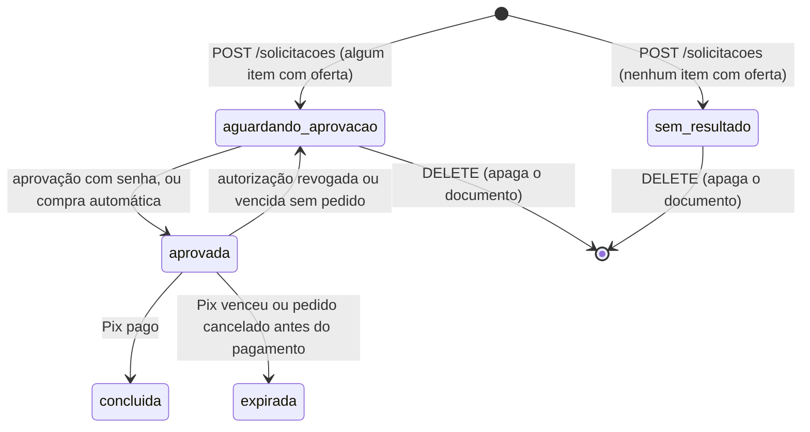

# Integração do front com o backend do Agentic Commerce

Guia para quem vai adaptar o `agentic-commerce-web` à API que está em produção: o Davi e o assistente de código dele.
Foi escrito a partir do código do backend na `main` (commit `51bf551`, 31/10/2026). Os exemplos de resposta foram
capturados rodando a API de verdade, com banco em memória e o catálogo `fixo`; só os ids e as datas mudam de uma
execução para outra.

---

## 0. Como usar este documento

**Fonte da verdade, nesta ordem:**

1. Este guia.
2. O código do backend (`iajuss/agentic-commerce-api`), se você tiver acesso, em especial
   `docs/plano-backend/00-contrato-de-integracao.md`, seção 10.
3. A API em produção (`http://54.209.228.101/api`), para conferir uma resposta.

**Não confie** no `docs/contrato-api.md` do front nem nos tipos atuais de `src/api/`. Eles descrevem o contrato
anterior ao pivô do backend ("uma intenção → várias ofertas"), que **não existe mais**. O modo de demonstração
(`src/api/demo.ts` e os blocos `demo` de cada módulo) imita esse contrato antigo.

**Regras que continuam valendo** (do `AGENTS.md` do front): identidade visual obrigatória (`docs/identidade-visual.md`),
textos em pt-BR, `pnpm lint` e `pnpm build` passando, uma branch e um PR por tarefa, nenhuma credencial no Git.

**O backend não muda por causa do front.** Se algo do backend parecer errado ou faltar, anote e avise o Lucas;
não contorne com gambiarra no front. As lacunas conhecidas estão na seção 11.

---

## 1. Resumo em 30 segundos

- **O produto mudou.** A pessoa escreve uma **lista de compras de mercado** ("arroz 5kg, 2 leites e detergente").
  A API separa os itens, busca ofertas no catálogo, filtra pelas políticas, ranqueia e devolve **uma cesta
  recomendada**: uma oferta por item, mais até 4 alternativas. A pessoa **aprova a cesta inteira** com a senha. A
  aprovação gera uma **autorização limitada**, que vale 15 minutos e um uso. O front então cria o **pedido**
  (`POST /pedidos`), que gera um **Pix simulado**. O pagamento é confirmado pelo **simulador de Pix**, e envio,
  entrega e devolução acontecem sozinhos com o tempo.
- **Compra automática:** se uma política `automatica` aceita a cesta inteira, o próprio `POST /solicitacoes` já
  aprova e cria o pedido. A resposta vem com `status: "aprovada"` e `compra_automatica.pedido_id`.
- **O front parou em 27/10**, antes do pivô. Contra a API real:
  - funcionam Entrar, Cadastro, Início e Políticas;
  - **quebram ao abrir** Perfil, Resultado e Auditoria;
  - **quebra** a Nova compra (envia o campo errado e não conhece os status);
  - Autorizações mostra campos vazios;
  - **não existem** a criação do pedido nem a tela de Pedidos. Sem elas, o fluxo principal não termina.
- **A infraestrutura está pronta:** a EC2 já serve o React e faz proxy de `/api`, e o build atual passa no lint e no
  `tsc`.

---

## 2. Ambientes e como o front chama a API

| Ambiente | Endereço da API | `VITE_API_URL` | CORS |
|---|---|---|---|
| Produção (EC2) | `http://54.209.228.101/api` | `/api` (mesmo endereço do front, sem CORS) | Não precisa |
| Front local → API de produção | `http://54.209.228.101/api` | `http://54.209.228.101/api` | `http://localhost:5173` já está liberado |
| Front local → API local | `http://localhost:5000` | `http://localhost:5000` | `http://localhost:5173` é o padrão do backend |

- `src/api/client.ts` já monta `${VITE_API_URL}${rota}` e funciona com `/api` relativo. **Não mude essa lógica.**
- Saúde: `GET /health` → `200 {"status": "ok", "banco": "ok"}`, ou `503` sem banco. O `apiIsUp()` do client usa
  essa rota.
- Desenvolver contra a **API de produção** é o caminho mais rápido: não precisa rodar Python nem Atlas. Atenção: o
  banco de produção é o mesmo do desenvolvimento (decisão do time). Use e-mails de teste únicos
  (`davi+teste1@exemplo.com`) e nunca dados pessoais reais.
- Rodar a API local é opcional e precisa do `.env` do backend, com credenciais que circulam só por canal privado:
  `flask --app wsgi run --debug`, em `http://localhost:5000`.

### Build de produção

```bash
pnpm install
pnpm build          # com VITE_API_URL=/api (veja abaixo)
```

**Armadilha no Windows/Git Bash:** `VITE_API_URL=/api pnpm build` no Git Bash grava `C:/Program Files/Git/api` no
bundle, porque o MSYS converte "caminhos". O site sobe, mas nenhuma chamada funciona. Use uma destas formas:

- **Recomendado:** versionar um `.env.production` na raiz do front com `VITE_API_URL=/api`. Não é segredo, e o
  `.gitignore` atual não o bloqueia. Depois disso, basta `pnpm build`.
- No Git Bash: `MSYS_NO_PATHCONV=1 VITE_API_URL=/api pnpm build`.
- No PowerShell: `$env:VITE_API_URL="/api"; pnpm build`.

Para conferir o bundle: `grep -o '`/api`' dist/assets/*.js` deve encontrar o texto.

---

## 3. Convenções da API

### Autenticação

- `POST /sessoes` devolve `{token, usuario}`. Envie `Authorization: Bearer <token>` em todas as outras rotas.
- **Rotas públicas:** só `GET /health`, `POST /usuarios` e `POST /sessoes`. Qualquer outra rota sem token responde
  `401`.
- O token vale **8 horas** (campo `exp` do JWT). O `AuthContext` atual já confere o `exp`; mantenha.
- O cadastro **não** devolve token: depois do `201`, faça o login. O `signUp` atual já faz isso; mantenha.

### Formato de erro (todas as rotas)

```json
{"erro": "Mensagem pronta para mostrar ao usuário.", "detalhes": {"campo": "problema do campo"}}
```

- `detalhes` só vem quando há algo por campo. Campos aninhados usam ponto (`"endereco.cep"`) e itens de lista usam
  índice (`"itens[0].descricao"`).
- **Exceção:** o `422` da aprovação traz `detalhes.motivos`, uma **lista** de textos, e não um mapa por campo.

| Status | Quando |
|---|---|
| `400` | Corpo inválido (cada campo em `detalhes`), corpo que não é objeto JSON, parâmetro inválido |
| `401` | Sem token, token inválido ou vencido, **ou senha errada** (veja abaixo) |
| `404` | Recurso não existe, **é de outra pessoa** ou o id está malformado (`{"erro": "Recurso não encontrado."}`) |
| `405` | Método não permitido na rota |
| `409` | Conflito com o estado atual (já aprovada, já paga, transição inválida...) |
| `422` | Regra de negócio: nenhuma política permite a cesta |
| `502` | Serviço externo falhou (ViaCEP, ou o catálogo inteiro indisponível) |

### O 401 que **não** encerra a sessão

`POST /solicitacoes/{id}/autorizacoes` com a senha errada responde:

```json
401 {"erro": "Senha incorreta.", "detalhes": {"senha": "Senha incorreta. Confira e tente de novo."}}
```

Um `401` **com `detalhes.senha`** significa senha errada: a pessoa continua logada e tenta de novo. Um `401` **sem**
`detalhes` significa sessão inválida: encerre a sessão e volte para `/entrar`. O `apiRequest` atual
(`src/api/client.ts`) **já faz exatamente isso**. Mantenha.

Mensagens de `401` sem detalhes: `"Faça login para continuar."` (sem token), `"Sessão inválida. Faça login novamente."`
e `"Sessão expirada. Faça login novamente."`.

### Formatos

- **Ids:** texto (ObjectId com 24 caracteres hexadecimais).
- **Datas:** ISO 8601 em UTC, com microssegundos: `"2026-10-31T20:43:54.434000+00:00"`. `new Date(texto)` funciona.
  Mostre no fuso do navegador, que é o que `utils/format.ts` já faz.
- **Dinheiro:** `number` em reais, até 2 casas (`40.97`). Formate com `formatBRL`.
- Campos de data seguem o gênero do recurso: `criada_em`/`atualizada_em` em solicitação, autorização e política;
  `criado_em`/`atualizado_em` em usuário, pedido, chamado e evento.
- **Criar** responde `201` com o recurso no corpo e o cabeçalho `Location` (exposto no CORS). **Excluir ou revogar**
  responde `204` sem corpo.
- Respostas de recursos podem trazer `usuario_id`. Ignore esse campo.

---

## 4. Domínio e máquinas de estado

### 4.1 Fluxo manual (o principal da demonstração)

```
1. POST /politicas                       (política manual, opcional)
2. POST /solicitacoes {texto}            → 201, status "aguardando_aprovacao", cesta recomendada
3. POST /solicitacoes/{id}/autorizacoes  {senha} → 201, autorização "ativa" (15 min, uso único)
                                           a solicitação vira "aprovada"
4. POST /pedidos {autorizacao_id}        → 201, pedido "aguardando_pagamento" com Pix (30 min)
                                           a autorização vira "usada"
5. POST /simulador-pix/pagamentos {txid} → 200, pedido "pago"; a solicitação vira "concluida"
6. GET /pedidos/{id}                     → o status avança sozinho: "enviado" (2 min depois do pagamento)
                                           → "entregue" (5 min depois do envio)
7. PATCH /pedidos/{id}                   → cancelar ou pedir devolução; POST .../chamados para pós-venda
```

**O passo 4 é responsabilidade do front e hoje não existe.** Sem ele, a autorização vence em 15 minutos e a
solicitação volta para `aguardando_aprovacao`.

### 4.2 Fluxo automático

Com uma política ativa `nivel_autonomia: "automatica"` que aceita a cesta inteira, com todos os itens tendo oferta e
o total abaixo do `orcamento_mensal` (se houver), o `POST /solicitacoes` faz os passos 3 e 4 sozinho e responde:

```json
{"status": "aprovada", "compra_automatica": {"autorizacao_id": "6ae6...aef", "pedido_id": "6ae6...af1"}, "...": "..."}
```

O front deve levar a pessoa direto ao pedido (`/pedidos/{pedido_id}`) para pagar o Pix. Não há senha nesse caminho.

Quando a compra automática não acontece, `compra_automatica` vem `null` e a solicitação fica `aguardando_aprovacao`,
à espera da aprovação manual com senha. Isso acontece em três casos:

- **A tentativa falhou:** `avaliacao.motivos` ganha "Não foi possível concluir a compra automática; aprove
  manualmente.".
- **O total passa do orçamento mensal:** `avaliacao.compra_automatica` vira `false` e o motivo do orçamento aparece em
  `avaliacao.motivos`.
- **Algum item ficou sem oferta:** a compra nem é tentada e **não há motivo gravado**, então
  `avaliacao.compra_automatica` pode vir `true` com status `aguardando_aprovacao`. A tela deve explicar ("Um item ficou
  sem oferta, então preciso da sua aprovação") em vez de prometer uma compra automática.

### 4.3 Status da solicitação



| Status | O que a tela mostra | Ações possíveis |
|---|---|---|
| `aguardando_aprovacao` | Cesta, total, lojas, motivos | Se `avaliacao.permitida`: **Aprovar com senha**. Se não, mostrar `avaliacao.motivos`, porque aprovar daria `422`. **Cancelar** sempre |
| `sem_resultado` | "Não encontrei ofertas para esta lista" | Cancelar (apaga), ou escrever outra lista |
| `aprovada` | Autorização ativa ou pedido aguardando Pix | Manual: criar o pedido (passo 4). Automática: ir ao pedido |
| `concluida` | Pagamento confirmado | Ver o pedido em `/pedidos` |
| `expirada` | O Pix venceu ou o pedido foi cancelado | Nenhuma; fazer uma nova lista |

**Não existe status `cancelada`.** O `DELETE` **apaga** a solicitação: depois dele, `GET /solicitacoes/{id}` responde
`404`. A tela deve voltar ao histórico, e o registro fica na auditoria.

### 4.4 Status da autorização

`ativa` → `usada` (virou pedido) | `revogada` (`DELETE /autorizacoes/{id}`) | `expirada` (passaram 15 minutos sem
pedido). Revogar ou expirar devolve a solicitação para `aguardando_aprovacao`.

### 4.5 Status do pedido

```mermaid
stateDiagram-v2
    [*] --> aguardando_pagamento: POST /pedidos
    aguardando_pagamento --> pago: POST /simulador-pix/pagamentos
    aguardando_pagamento --> expirado: 30 min sem pagamento (automático)
    aguardando_pagamento --> cancelado: PATCH status=cancelado
    pago --> enviado: 2 min depois do pagamento (automático)
    enviado --> entregue: 5 min depois do envio (automático)
    pago --> cancelado: PATCH (reembolso simulado)
    enviado --> cancelado: PATCH (reembolso simulado)
    entregue --> devolucao_solicitada: PATCH com motivo (até 7 dias após a entrega)
    devolucao_solicitada --> devolvido: 5 min depois (automático, reembolso simulado)
```



- As transições automáticas são **aplicadas na leitura** (`GET /pedidos/{id}` e `GET /pedidos`). O front precisa
  **reler** o pedido para ver o avanço: um botão "Atualizar" e/ou um polling leve (a cada 15–30 s) enquanto o pedido
  estiver em `aguardando_pagamento`, `pago`, `enviado` ou `devolucao_solicitada`.
- O `historico` traz cada mudança com a hora em que ela aconteceu: use numa linha do tempo.
- O `pix.copia_e_cola` só aparece enquanto o pedido está em `aguardando_pagamento`. Não há QR code
  (`qr_code_base64: null`). O front pode desenhar um a partir do `copia_e_cola` ou mostrar só o texto com um botão de
  copiar.

### 4.6 Prazos (valores de produção)

| O quê | Prazo |
|---|---|
| Token de login | 8 h |
| Autorização sem virar pedido | 15 min |
| Pix sem pagamento | 30 min |
| Envio após o pagamento | 2 min |
| Entrega após o envio | 5 min |
| Devolvido após pedir devolução | 5 min |
| Janela para pedir devolução | 7 dias após a entrega |

---

## 5. Referência das rotas (27)

| # | Método e rota | Pública | Sucesso | Erros |
|---|---|---|---|---|
| 1 | `GET /health` | sim | 200 | 503 |
| 2 | `POST /usuarios` | sim | 201 | 400, 409 |
| 3 | `POST /sessoes` | sim | 200 | 401 |
| 4 | `GET /usuarios/me` | | 200 | 401 |
| 5 | `PATCH /usuarios/me` | | 200 | 400, 502 |
| 6 | `GET /politicas` | | 200 | |
| 7 | `POST /politicas` | | 201 | 400 |
| 8 | `GET /politicas/{id}` | | 200 | 404 |
| 9 | `PUT /politicas/{id}` | | 200 | 400, 404 |
| 10 | `DELETE /politicas/{id}` | | 204 | 404 |
| 11 | `POST /solicitacoes` | | 201 | 400, 502 |
| 12 | `GET /solicitacoes` | | 200 | |
| 13 | `GET /solicitacoes/{id}` | | 200 | 404 |
| 14 | `DELETE /solicitacoes/{id}` | | 204 | 404, 409 |
| 15 | `POST /solicitacoes/{id}/autorizacoes` | | 201 | 400, 401, 404, 409, 422 |
| 16 | `GET /autorizacoes` | | 200 | |
| 17 | `GET /autorizacoes/{id}` | | 200 | 404 |
| 18 | `DELETE /autorizacoes/{id}` | | 204 | 404, 409 |
| 19 | `POST /pedidos` | | 201 | 400, 404, 409 |
| 20 | `GET /pedidos` | | 200 | |
| 21 | `GET /pedidos/{id}` | | 200 | 404 |
| 22 | `PATCH /pedidos/{id}` | | 200 | 400, 404, 409 |
| 23 | `POST /simulador-pix/pagamentos` | | 200 | 400, 404, 409 |
| 24 | `POST /pedidos/{id}/chamados` | | 201 | 400, 404 |
| 25 | `GET /pedidos/{id}/chamados` | | 200 | 404 |
| 26 | `GET /pedidos/{id}/chamados/{chamado_id}` | | 200 | 404 |
| 27 | `GET /auditoria?limite=&antes_de=` | | 200 | 400 |

Todas as rotas não públicas também podem responder `401`.

### 5.1 Conta

**`POST /usuarios`**: corpo `{"nome", "email", "senha"}`. O nome tem 1 a 80 caracteres, o e-mail precisa ser válido
e a senha tem **8 a 128** caracteres.

```json
201  Location: /usuarios/me
{"id": "6ae6530a9aa41d22df719ac4", "nome": "Ana Souza", "email": "ana@exemplo.com"}

400 {"erro": "Dados de cadastro inválidos.", "detalhes": {"nome": "Informe um nome de até 80 caracteres.",
     "email": "Informe um e-mail válido.", "senha": "Use uma senha de 8 a 128 caracteres."}}
409 {"erro": "E-mail já cadastrado.", "detalhes": {"email": "Use outro e-mail."}}
```

**`POST /sessoes`**: corpo `{"email", "senha"}`.

```json
200 {"token": "eyJhbGciOiJIUzI1NiIs...", "usuario": {"id": "6ae6530a9aa41d22df719ac4", "nome": "Ana Souza", "email": "ana@exemplo.com"}}
401 {"erro": "E-mail ou senha inválidos."}
```

**`GET /usuarios/me`**: o perfil de quem acabou de se cadastrar:

```json
{
  "id": "6ae6530a9aa41d22df719ac4", "nome": "Ana Souza", "email": "ana@exemplo.com",
  "data_nascimento": null, "endereco": null, "orcamento_mensal": null,
  "preferencias": {"marcas_preferidas": [], "marcas_evitadas": []},
  "criado_em": "2026-10-31T20:43:54.434000+00:00"
}
```

**Não existem** `prioridade`, `lojas_preferidas` nem `atualizado_em`. O front atual espera esses campos e a tela
quebra.

**`PATCH /usuarios/me`**: aceita **qualquer subconjunto** dos campos abaixo. Campos desconhecidos são ignorados, e o
`email` não é editável.

```json
{
  "nome": "Ana Souza",
  "data_nascimento": "1995-04-12",
  "orcamento_mensal": 800,
  "preferencias": {"marcas_preferidas": ["Vale Verde"], "marcas_evitadas": ["Econômico"]},
  "endereco": {"cep": "01310-100", "numero": "1000", "complemento": "Apto 12"}
}
```

A resposta (`200`) é o perfil completo. O CEP volta **com máscara**, as marcas voltam **em minúsculas** e o resto do
endereço vem do ViaCEP:

```json
{
  "id": "6ae6530a9aa41d22df719ac4", "nome": "Ana Souza", "email": "ana@exemplo.com",
  "data_nascimento": "1995-04-12", "orcamento_mensal": 800.0,
  "preferencias": {"marcas_preferidas": ["vale verde"], "marcas_evitadas": ["econômico"]},
  "endereco": {"cep": "01310-100", "logradouro": "Avenida Paulista", "numero": "1000", "complemento": "Apto 12",
               "bairro": "Bela Vista", "cidade": "São Paulo", "uf": "SP"},
  "criado_em": "2026-10-31T20:43:54.434000+00:00"
}
```

Regras e erros do `PATCH`:

| Campo | Regra | Chave do erro (400) |
|---|---|---|
| `nome` | 1 a 80 caracteres | `nome` |
| `data_nascimento` | `"AAAA-MM-DD"`, anterior a hoje. **Não pode ser apagada** (`null` dá erro) | `data_nascimento` |
| `orcamento_mensal` | número > 0, ou `null` para remover | `orcamento_mensal` |
| `preferencias.marcas_preferidas` / `marcas_evitadas` | lista de textos (cada chave é opcional; a que não vier fica como está) | `preferencias.marcas_preferidas` / `preferencias.marcas_evitadas` |
| `endereco` | `null` apaga. Objeto com `cep` (8 dígitos, com ou sem hífen), `numero` (1 a 20 caracteres) e `complemento` (até 60). Sem endereço salvo, o `cep` é obrigatório | `endereco.cep`, `endereco.numero`, `endereco.complemento` |

```json
400 {"erro": "Perfil inválido.", "detalhes": {"nome": "Informe um nome de até 80 caracteres.",
     "orcamento_mensal": "Informe um valor maior que zero ou null.",
     "endereco.cep": "Informe um CEP com 8 dígitos.", "endereco.numero": "Informe um número de até 20 caracteres."}}
400 {"erro": "CEP não encontrado.", "detalhes": {"endereco.cep": "Confira o CEP."}}
502 {"erro": "Serviço de CEP indisponível no momento. Tente novamente em instantes."}
```

**Por que esses campos importam no produto:**
- **`marcas_preferidas`** dão bônus no ranking; **`marcas_evitadas`** dão penalidade.
- **`data_nascimento`:** sem ela, ou com menos de 18 anos, **bebidas alcoólicas ficam fora das ofertas**.
- **`orcamento_mensal`:** se a cesta passar dele, a compra automática vira manual, com motivo em `avaliacao.motivos`.

### 5.2 Políticas (sem mudança: o front atual já está certo)

Corpo de `POST` e `PUT`:

```json
{"nome": "Mercado do mês", "teto_por_compra": 300, "categorias": ["Alimentos e Bebidas", "Casa e Limpeza"],
 "lojas": [], "nivel_autonomia": "manual", "ativa": true}
```

```json
201  Location: /politicas/6ae6530a9aa41d22df719aca
{"id": "6ae6530a9aa41d22df719aca", "usuario_id": "6ae6530a9aa41d22df719ac4", "nome": "Mercado do mês",
 "teto_por_compra": 300.0, "categorias": ["alimentos e bebidas", "casa e limpeza"], "lojas": [],
 "nivel_autonomia": "manual", "ativa": true,
 "criada_em": "2026-10-31T20:43:54.712458+00:00", "atualizada_em": "2026-10-31T20:43:54.712458+00:00"}

400 {"erro": "Política inválida.", "detalhes": {"nome": "Informe um nome.", "teto_por_compra": "Informe um valor maior que zero."}}
```

- `categorias` e `lojas` vazias valem para qualquer uma. Os valores voltam em minúsculas.
- `PUT` **substitui tudo**: campo ausente volta ao padrão (`categorias: []`, `lojas: []`, `manual`, `ativa: true`).
  Por isso, mande sempre o formulário inteiro, como o front já faz.
- Uma cesta é permitida se **uma mesma política ativa** aceita todos os itens **e** o total (com frete) cabe no teto.
  Sem nenhuma política ativa, tudo é permitido, mas **nunca** há compra automática.
- **Categorias:** a comparação usa o **caminho** da oferta, ignorando maiúsculas e acentos. Uma política com
  "Alimentos e Bebidas" aceita arroz, leite e cerveja; com "Bebidas", aceita refrigerantes, águas e alcoólicas. As
  sugestões de categoria do front (`src/utils/categories.ts`) são de eletrônicos e **bloqueiam o catálogo inteiro**.
  Troque pelas categorias reais (seção 6).

### 5.3 Solicitações (a mudança grande)

**`POST /solicitacoes`**: envie **exatamente um** destes formatos:

```json
{"texto": "arroz 5kg, 2 leites integrais, detergente e guarda-chuva"}
{"itens": [{"descricao": "café 500g", "quantidade": 2}]}
```

- O `texto` tem 3 a 500 caracteres. A API separa os itens por vírgula, ponto e vírgula, quebra de linha e " e ", e
  lê quantidades em dígitos ("2 leites", "2x leite") ou por extenso até dez ("duas caixas de sabão"). "2 kg de
  feijão" é medida, não quantidade.
- Os `itens` vão de 1 a 20, a `descricao` tem até 80 caracteres e a `quantidade` é inteira de 1 a 99 (padrão 1).
- **O campo `intencao` não existe.** Mandar só `{"intencao": ...}` responde
  `400 {"erro": "Solicitação inválida.", "detalhes": {"texto": "Envie o texto da lista de compras ou os itens, não os dois."}}`
  (a mensagem fala "não os dois" mesmo quando não veio nenhum dos dois).
- Outros erros, todos na chave `texto`: `"Escreva a lista com 3 a 500 caracteres."`,
  `"Não encontramos itens na lista."` e `"Use no máximo 20 itens por solicitação."`. Com `itens`, os erros vêm em
  `itens`, `itens[0].descricao` e `itens[0].quantidade`.
- `502 {"erro": "Catálogo indisponível no momento. Tente novamente em instantes."}` só quando o catálogo falha em
  **todos** os itens.
- **É síncrono:** a resposta já traz o resultado final. **Não existe** status `processando`, então não precisa de
  polling.

**Resposta `201`** (`Location: /solicitacoes/{id}`). Exemplo real, com as alternativas encurtadas (cada item traz até
4, no mesmo formato da `recomendada`):

```json
{
  "id": "6ae6530a9aa41d22df719acc",
  "texto": "arroz 5kg, 2 leites integrais, detergente e guarda-chuva",
  "status": "aguardando_aprovacao",
  "itens": [
    {
      "descricao": "arroz 5kg",
      "quantidade": 1,
      "status": "com_oferta",
      "recomendada": {
        "id_externo": "FIXO-001", "fonte": "fixo", "titulo": "Arroz Branco Tipo 1 5kg", "marca": "Grão Dourado",
        "preco": 27.9, "frete": 0.0, "frete_gratis": true, "prazo_dias": 2, "estoque": null, "avaliacao": 4.7,
        "categoria": "Arroz", "categorias_caminho": ["Alimentos e Bebidas", "Mercearia", "Arroz"],
        "loja": "Mercado Exemplo", "link": null, "imagem": null,
        "pontuacao": 1.0872, "preco_por_unidade": 5.58, "unidade": "kg",
        "explicacao": ["Preço por kg: R$ 5,58/kg", "Frete grátis", "Entrega estimada em 2 dias", "Avaliação 4,7",
                       "Embalagem igual à pedida (5 kg)"]
      },
      "alternativas": [
        {
          "id_externo": "FIXO-003", "fonte": "fixo", "titulo": "Arroz Parboilizado 5kg", "marca": "Sabor do Campo",
          "preco": 24.9, "frete": 9.9, "frete_gratis": false, "prazo_dias": 4, "estoque": null, "avaliacao": 4.3,
          "categoria": "Arroz", "categorias_caminho": ["Alimentos e Bebidas", "Mercearia", "Arroz"],
          "loja": "Atacado Bom Preço", "link": null, "imagem": null,
          "pontuacao": 0.847, "preco_por_unidade": 4.98, "unidade": "kg",
          "explicacao": ["Menor preço por kg entre 4 ofertas: R$ 4,98/kg", "Frete de R$ 9,90",
                         "Entrega estimada em 4 dias", "Avaliação 4,3", "Embalagem igual à pedida (5 kg)"]
        }
      ],
      "descartadas": 0,
      "explicacao": ["4 ofertas encontradas"]
    },
    {
      "descricao": "leites integrais",
      "quantidade": 2,
      "status": "com_oferta",
      "recomendada": {"titulo": "Leite Integral UHT 1L", "preco": 5.29, "loja": "Mercado Exemplo", "marca": "Vale Verde",
                      "unidade": "l", "explicacao": ["Preço por L: R$ 5,29/L", "Frete grátis",
                      "Entrega estimada em 1 dia", "Avaliação 4,8", "Marca preferida"], "...": "mesmo formato"},
      "alternativas": ["..."],
      "descartadas": 0,
      "explicacao": ["3 ofertas encontradas"]
    },
    {
      "descricao": "guarda-chuva",
      "quantidade": 1,
      "status": "sem_oferta",
      "recomendada": null,
      "alternativas": [],
      "descartadas": 0,
      "explicacao": ["Nenhuma oferta encontrada para este item"]
    }
  ],
  "cesta": {"subtotal": 40.97, "frete": 0.0, "total": 40.97, "lojas": ["Mercado Exemplo"]},
  "avaliacao": {"permitida": true, "compra_automatica": false, "politica_id": "6ae6530a9aa41d22df719aca", "motivos": []},
  "compra_automatica": null,
  "criada_em": "2026-10-31T20:43:54.718000+00:00",
  "atualizada_em": "2026-10-31T20:43:54.718000+00:00"
}
```

Como ler cada campo:

| Campo | Significado | Uso na tela |
|---|---|---|
| `itens[].quantidade` | **Número de embalagens** da recomendada a comprar (a API ajusta: "2 kg de feijão" com pacote de 1 kg vira 2) | "2 × Leite Integral UHT 1L" |
| `itens[].status` | `com_oferta` ou `sem_oferta` | Item sem oferta: aviso e fora da cesta |
| `itens[].recomendada` | A oferta escolhida para o item (`null` em `sem_oferta`) | Card principal do item |
| `itens[].alternativas` | Até 4 outras ofertas, já ranqueadas | **Só informativas**: não há rota para trocar a oferta escolhida |
| `itens[].descartadas` | Ofertas removidas pelas políticas ou pela idade | "2 ofertas descartadas" |
| `itens[].explicacao` | Frases do **item**: quantas ofertas, descartes e motivos, ajuste de embalagem ("Você pediu 2 kg: 2 embalagens de 1 kg") | Lista de texto |
| `recomendada.explicacao` | Frases de **por que esta oferta**: preço por unidade, frete, prazo, avaliação, marca preferida ou evitada, embalagem pedida | Lista de texto ou chips |
| `recomendada.preco_por_unidade` + `unidade` | Preço por `kg`, `l` ou `un` (pode ser `null`) | "R$ 5,58/kg"; mostre `l` como "L" |
| `recomendada.pontuacao` | Nota interna do ranking | Não precisa mostrar |
| `recomendada.imagem` / `link` | `null` no catálogo fixo; a DummyJSON traz a URL da miniatura | Placeholder quando `null` |
| `recomendada.frete` | `null` = a loja não informou (a cesta estima R$ 15,00 por loja) | |
| `cesta` | Soma das recomendadas × quantidade, com o frete cobrado **uma vez por loja** | Resumo: subtotal, frete, total e lojas |
| `avaliacao.permitida` | Se alguma política aceita a cesta inteira | `false` → mostrar `motivos` e não oferecer aprovar |
| `avaliacao.compra_automatica` | Se a política escolhida é automática | |
| `avaliacao.motivos` | Por que bloqueou, ou por que não comprou sozinho | Lista de avisos |
| `compra_automatica` | `{autorizacao_id, pedido_id}` quando o agente comprou sozinho; senão `null` | Ir para `/pedidos/{pedido_id}` |

Exemplo de cesta **bloqueada** (teto de R$ 30,00):

```json
"status": "aguardando_aprovacao",
"avaliacao": {"permitida": false, "compra_automatica": false, "politica_id": null,
              "motivos": ["Mercado do mês: total de R$ 47,80 passa do teto de R$ 30,00"]}
```

Nesse caso, um item pode trazer
`"explicacao": ["4 ofertas encontradas", "1 descartada: Mercado do mês: total de R$ 32,45 passa do teto de R$ 30,00"]`.

Exemplo **sem resultado**:

```json
"status": "sem_resultado",
"cesta": {"subtotal": 0, "frete": 0, "total": 0, "lojas": []},
"avaliacao": {"permitida": false, "compra_automatica": false, "politica_id": null,
              "motivos": ["Nenhum item da lista tem oferta disponível"]}
```

**`GET /solicitacoes`**: histórico, das mais recentes para as mais antigas, **sem** os detalhes:

```json
[{"id": "6ae6530a9aa41d22df719acc", "texto": "arroz 5kg, 2 leites integrais, detergente e guarda-chuva",
  "itens": ["arroz 5kg", "leites integrais", "detergente", "guarda-chuva"],
  "status": "aguardando_aprovacao", "total": 40.97, "criada_em": "2026-10-31T20:43:54.718000+00:00"}]
```

O `texto` é `null` quando a solicitação foi criada com `itens`. Nesse caso, mostre `itens.join(", ")`.

**`GET /solicitacoes/{id}`**: o documento completo, como no `POST`.
`404 {"erro": "Solicitação não encontrada."}`.

**`DELETE /solicitacoes/{id}`** → `204`. Só vale em `aguardando_aprovacao` e `sem_resultado`, e **apaga** a
solicitação. Em qualquer outro status:
`409 {"erro": "Esta solicitação já foi aprovada e não pode ser cancelada."}`.

### 5.4 Aprovação e autorizações

**`POST /solicitacoes/{id}/autorizacoes`**: corpo **`{"senha": "..."}`**. Não existe `oferta_id`: a aprovação vale
para a **cesta recomendada inteira** (os itens `com_oferta`). A senha é obrigatória, porque esta rota é só para o
fluxo manual.

```json
201  Location: /autorizacoes/6ae6530a9aa41d22df719acf
{
  "id": "6ae6530a9aa41d22df719acf",
  "solicitacao_id": "6ae6530a9aa41d22df719acc",
  "origem": "manual",
  "politica_id": "6ae6530a9aa41d22df719aca",
  "valor_maximo": 40.97,
  "lojas": ["Mercado Exemplo"],
  "itens": [
    {"id_externo": "FIXO-001", "titulo": "Arroz Branco Tipo 1 5kg", "preco": 27.9, "quantidade": 1, "loja": "Mercado Exemplo"},
    {"id_externo": "FIXO-008", "titulo": "Leite Integral UHT 1L", "preco": 5.29, "quantidade": 2, "loja": "Mercado Exemplo"},
    {"id_externo": "FIXO-024", "titulo": "Detergente Líquido Neutro 500ml", "preco": 2.49, "quantidade": 1, "loja": "Mercado Exemplo"}
  ],
  "status": "ativa",
  "expira_em": "2026-10-31T20:58:54.918000+00:00",
  "criada_em": "2026-10-31T20:43:54.918000+00:00",
  "atualizada_em": "2026-10-31T20:43:54.918000+00:00"
}
```

| Situação | Resposta |
|---|---|
| Sem senha | `400 {"erro": "Aprovação inválida.", "detalhes": {"senha": "Informe a senha."}}` |
| Senha errada | `401 {"erro": "Senha incorreta.", "detalhes": {"senha": "Senha incorreta. Confira e tente de novo."}}` (a sessão **continua**) |
| Solicitação não existe | `404 {"erro": "Solicitação não encontrada."}` |
| Não está `aguardando_aprovacao` | `409 {"erro": "Esta solicitação não está aguardando aprovação."}` |
| Nenhuma política permite | `422 {"erro": "Nenhuma política permite esta compra.", "detalhes": {"motivos": ["Mercado do mês: total de R$ 47,80 passa do teto de R$ 30,00"]}}` |

- **Não existem** `titulo`, `loja`, `oferta_id`, `automatica` nem `politica_nome`. Use `itens[]`, `lojas[]` e
  `origem` (`"manual"` ou `"automatica"`). O nome da política não vem: se quiser mostrar, busque em `GET /politicas`
  pelo `politica_id`, que pode ser `null`.
- A validade é de **15 minutos**, e não 30, como a tela promete hoje.
- `isWrongPassword` e `policyReasons` em `src/api/autorizacoes.ts` já leem `401 + detalhes.senha` e
  `422 + detalhes.motivos` corretamente. Reaproveite.

**`GET /autorizacoes`**: só as **ativas e dentro do prazo**, das mais recentes para as mais antigas, no formato
acima. **Não traz histórico**: usadas, revogadas e expiradas não aparecem (seção 11).

**`GET /autorizacoes/{id}`**: qualquer status. Pode trazer `usada_em`, `revogada_em` ou `expirada_em`.
`404 {"erro": "Autorização não encontrada."}`.

**`DELETE /autorizacoes/{id}`** → `204`. Revoga a ativa e devolve a solicitação para `aguardando_aprovacao`. Revogar
uma já revogada ou expirada também responde `204`. Uma já usada responde
`409 {"erro": "Esta autorização já foi usada em um pedido."}`.

### 5.5 Pedidos e Pix

**`POST /pedidos`**: corpo `{"autorizacao_id": "..."}`. Consome a autorização (uso único) e cria a cobrança Pix.

```json
201  Location: /pedidos/6ae6530a9aa41d22df719ad1
{
  "id": "6ae6530a9aa41d22df719ad1",
  "solicitacao_id": "6ae6530a9aa41d22df719acc",
  "autorizacao_id": "6ae6530a9aa41d22df719acf",
  "status": "aguardando_pagamento",
  "itens": [
    {"id_externo": "FIXO-001", "titulo": "Arroz Branco Tipo 1 5kg", "preco": 27.9, "quantidade": 1, "loja": "Mercado Exemplo"},
    {"id_externo": "FIXO-008", "titulo": "Leite Integral UHT 1L", "preco": 5.29, "quantidade": 2, "loja": "Mercado Exemplo"},
    {"id_externo": "FIXO-024", "titulo": "Detergente Líquido Neutro 500ml", "preco": 2.49, "quantidade": 1, "loja": "Mercado Exemplo"}
  ],
  "total": 40.97,
  "pix": {"txid": "4d7bd3943f009a2fe684136a06f66e17", "copia_e_cola": "PIX-SIMULADO-4d7bd3943f009a2fe684136a06f66e17",
          "qr_code_base64": null, "expira_em": "2026-10-31T21:13:54.924000+00:00", "pago_em": null},
  "historico": [{"status": "aguardando_pagamento", "em": "2026-10-31T20:43:54.924000+00:00"}],
  "entrega": {"simulada": true},
  "criado_em": "2026-10-31T20:43:54.924000+00:00"
}
```

Erros: `400 {"erro": "Pedido inválido.", "detalhes": {"autorizacao_id": "Informe a autorização."}}`,
`404 {"erro": "Autorização não encontrada."}` e
`409 {"erro": "Autorização expirada, revogada ou já usada."}`.

**`POST /simulador-pix/pagamentos`**: corpo `{"txid": "<pix.txid do pedido>"}`. Simula o pagamento e devolve o pedido
atualizado. **Existe só para a demonstração:** na tela do pedido, mostre um botão como "Simular pagamento do Pix",
deixando claro que é uma simulação.

```json
200 {"id": "6ae6530a9aa41d22df719ad1", "status": "pago",
     "pix": {"txid": "4d7bd3943f009a2fe684136a06f66e17", "pago_em": "2026-10-31T20:43:54.926000+00:00"},
     "historico": [{"status": "aguardando_pagamento", "em": "..."}, {"status": "pago", "em": "..."}], "...": "resto igual"}
```

Erros: `404 {"erro": "Cobrança Pix não encontrada."}`, `409 {"erro": "Esta cobrança Pix expirou."}` e
`409 {"erro": "Este pedido não está aguardando pagamento."}`.

Depois de pago, o `pix` passa a ter **só** `txid` e `pago_em`: o `copia_e_cola` some.

**`GET /pedidos`**: resumo, dos mais recentes para os mais antigos:

```json
[{"id": "6ae6530b9aa41d22df719af1", "status": "aguardando_pagamento", "total": 28.48, "quantidade_itens": 3, "criado_em": "..."},
 {"id": "6ae6530b9aa41d22df719adc", "status": "cancelado", "total": 39.8, "quantidade_itens": 2, "criado_em": "..."},
 {"id": "6ae6530a9aa41d22df719ad1", "status": "devolvido", "total": 40.97, "quantidade_itens": 4, "criado_em": "..."}]
```

`quantidade_itens` é a soma das quantidades (embalagens), não o número de linhas.

**`GET /pedidos/{id}`**: o comprovante completo, com as transições automáticas já aplicadas. Exemplo de um pedido
entregue e depois devolvido:

```json
{
  "id": "6ae6530a9aa41d22df719ad1", "status": "devolvido", "total": 40.97, "itens": ["..."],
  "pix": {"txid": "4d7bd394...", "pago_em": "2026-10-31T20:43:54.926000+00:00"},
  "historico": [
    {"status": "aguardando_pagamento", "em": "2026-10-31T20:43:54.924000+00:00"},
    {"status": "pago", "em": "2026-10-31T20:43:54.926000+00:00"},
    {"status": "enviado", "em": "2026-10-31T20:43:54.926000+00:00"},
    {"status": "entregue", "em": "2026-10-31T20:43:54.926000+00:00"},
    {"status": "devolucao_solicitada", "em": "2026-10-31T20:43:54.934000+00:00"},
    {"status": "devolvido", "em": "2026-10-31T20:43:54.934000+00:00"}
  ],
  "devolucao": {"motivo": "Caixa de leite amassada."},
  "reembolso": {"valor": 40.97, "status": "simulado", "em": "2026-10-31T20:43:54.934000+00:00"},
  "entrega": {"simulada": true},
  "solicitacao_id": "6ae6530a9aa41d22df719acc", "autorizacao_id": "6ae6530a9aa41d22df719acf",
  "criado_em": "2026-10-31T20:43:54.924000+00:00"
}
```

Neste exemplo os horários coincidem porque a captura usou prazos zerados. Em produção, eles vêm separados pelos
prazos da seção 4.6.

`404 {"erro": "Pedido não encontrado."}`. `reembolso` e `devolucao` só aparecem quando existem.

### 5.6 Pós-compra

**`PATCH /pedidos/{id}`**: o corpo é um destes:

```json
{"status": "cancelado"}
{"status": "devolucao_solicitada", "motivo": "Caixa de leite amassada."}
```

- **Cancelar** vale em `aguardando_pagamento` (a solicitação vira `expirada`), `pago` e `enviado`. Nos dois últimos
  há reembolso simulado.
- **Devolução** vale só em `entregue`, até 7 dias depois da entrega, com `motivo` de 3 a 300 caracteres. Cerca de
  5 minutos depois, o pedido vira `devolvido`, com `reembolso`.
- A resposta (`200`) é o pedido atualizado.
- Erros:
  - `400 {"erro": "Mudança de pedido inválida.", "detalhes": {"status": "Use \"cancelado\" ou \"devolucao_solicitada\"."}}`
  - `400 {..., "detalhes": {"motivo": "Informe o motivo, de 3 a 300 caracteres."}}`
  - `409 {"erro": "Não é possível mudar o pedido de cancelado para cancelado."}`
  - `409 {"erro": "O prazo de 7 dias para devolução terminou."}`

Botões por status:

| Status do pedido | Ações na tela |
|---|---|
| `aguardando_pagamento` | Copiar o Pix, **Simular pagamento**, Cancelar |
| `pago`, `enviado` | Cancelar (com reembolso simulado), Abrir chamado |
| `entregue` | Pedir devolução (com motivo), Abrir chamado |
| `devolucao_solicitada` | Abrir chamado (aguardar `devolvido`) |
| `expirado`, `cancelado`, `devolvido` | Só leitura (chamado continua possível) |

**Chamados:**

```json
POST /pedidos/{id}/chamados  {"assunto": "Embalagem amassada", "mensagem": "O leite chegou com a caixa amassada."}
201  Location: /pedidos/{id}/chamados/{chamado_id}
{"id": "6ae6530a9aa41d22df719ad5", "pedido_id": "6ae6530a9aa41d22df719ad1", "assunto": "Embalagem amassada",
 "mensagem": "O leite chegou com a caixa amassada.", "status": "aberto",
 "criado_em": "2026-10-31T20:43:54.931000+00:00", "atualizado_em": "2026-10-31T20:43:54.931000+00:00"}

400 {"erro": "Chamado inválido.", "detalhes": {"assunto": "Informe o assunto, de 3 a 80 caracteres.",
     "mensagem": "Informe a mensagem, de 10 a 1000 caracteres."}}
```

- `GET /pedidos/{id}/chamados` devolve a lista do pedido.
- `GET /pedidos/{id}/chamados/{chamado_id}` devolve um chamado (`404 {"erro": "Chamado não encontrado."}`).
- O status é sempre `aberto` no MVP, porque não há resposta da loja.

### 5.7 Auditoria

**`GET /auditoria?limite=50&antes_de=<id>`**: a trilha da pessoa, da mais recente para a mais antiga, **paginada**.

```json
{
  "eventos": [
    {"id": "6ae6530b9aa41d22df719af2", "tipo": "pedido_criado", "recurso": {"tipo": "pedido", "id": "6ae6530b9aa41d22df719af1"},
     "dados": {"total": 28.48}, "criado_em": "2026-10-31T20:43:55.240000+00:00"},
    {"id": "6ae6530b9aa41d22df719af0", "tipo": "autorizacao_emitida", "recurso": {"tipo": "autorizacao", "id": "6ae6530b9aa41d22df719aef"},
     "dados": {"origem": "automatica"}, "criado_em": "2026-10-31T20:43:55.240000+00:00"}
  ],
  "proximo": "6ae6530b9aa41d22df719aee"
}
```

- `limite` vai de 1 a 100 (padrão 50). Para a próxima página, passe `antes_de=<proximo>`. `proximo: null` significa
  que acabou.
- Erros: `400 {"erro": "Parâmetros de auditoria inválidos.", "detalhes": {"limite": "Use um inteiro de 1 a 100."}}`
  e `{"antes_de": "Use um id válido."}`.
- **Não existem** `ator` nem `descricao`. O front precisa de um mapa `tipo → ícone, quem agiu e frase`. Sugestão,
  com os **20 tipos** que a API grava:

| `tipo` | `recurso.tipo` | `dados` | Quem agiu | Frase sugerida |
|---|---|---|---|---|
| `usuario_cadastrado` | usuario | — | você | Você criou sua conta |
| `sessao_iniciada` | usuario | — | você | Você entrou na conta |
| `login_recusado` | usuario | — | sistema | Tentativa de entrar com senha errada |
| `perfil_atualizado` | usuario | `campos: string[]` | você | Você atualizou o perfil (nome, endereço...) |
| `politica_criada` | politica | — | você | Você criou uma política |
| `politica_substituida` | politica | — | você | Você alterou uma política |
| `politica_removida` | politica | — | você | Você excluiu uma política |
| `solicitacao_criada` | solicitacao | `itens: number, status` | você | Você enviou uma lista com N itens |
| `solicitacao_cancelada` | solicitacao | — | você | Você cancelou uma lista |
| `autorizacao_emitida` | autorizacao | `origem: "manual" \| "automatica"` | você (manual) / agente (automática) | Você aprovou a compra / O agente comprou sozinho, dentro da política |
| `reautenticacao_recusada` | solicitacao | — | sistema | Senha incorreta na aprovação: nada foi aprovado |
| `autorizacao_revogada` | autorizacao | — | você | Você revogou uma autorização |
| `autorizacao_expirada` | autorizacao | — | sistema | Uma autorização venceu sem virar pedido |
| `pedido_criado` | pedido | `total: number` | sistema | Pedido criado: Pix de R$ X |
| `pagamento_confirmado` | pedido | `total: number` | sistema | Pagamento confirmado: R$ X |
| `pedido_expirado` | pedido | — | sistema | O Pix venceu e o pedido expirou |
| `pedido_cancelado` | pedido | — | você | Você cancelou um pedido |
| `pedido_entregue` | pedido | — | sistema | Pedido entregue |
| `devolucao_solicitada` | pedido | — | você | Você pediu a devolução |
| `chamado_aberto` | chamado | — | você | Você abriu um chamado |

  Um tipo desconhecido deve aparecer com um ícone genérico, sem quebrar a tela. Não há evento para "enviado" nem para
  "devolvido": esses passos aparecem só no `historico` do pedido.

---

## 6. Catálogo: o que dá resultado

Em produção, o catálogo é `combinado`: o **fixo**, local, com 44 produtos de mercado e 4 lojas fictícias, mais a
**DummyJSON** (categoria groceries, com títulos em inglês e loja "DummyJSON").

- **Categorias reais**, para as sugestões da política (`src/utils/categories.ts`):
  - **Raízes:** Alimentos e Bebidas, Casa e Limpeza, Higiene e Cuidado Pessoal.
  - **Intermediárias:** Mercearia, Laticínios, Bebidas, Bebidas Alcoólicas, Padaria, Limpeza, Lavanderia.
  - **Folhas:** Arroz, Feijão, Leite, Café, Açúcar, Óleos, Massas, Detergente, Sabão em Pó, Papel Higiênico,
    Refrigerantes, Cervejas, Vinhos, Ovos, Pão de Forma, Águas.
  - **Da DummyJSON:** só Mercearia (o caminho delas é apenas `["Mercearia"]`). Por isso, uma política com "Alimentos e
    Bebidas" descarta as ofertas da DummyJSON, e uma com "Mercearia" aceita as duas fontes.
- **Lojas do fixo** (para `lojas` da política): Mercado Exemplo, Atacado Bom Preço, Empório da Esquina,
  Super Econômico. As ofertas da DummyJSON usam a **marca como loja**, ou "DummyJSON" quando não há marca.
- **Marcas** (para o perfil): Grão Dourado, Sabor do Campo, Vale Verde, Fazenda Feliz, Bom Dia, Serra Alta, Limpex,
  Brilho, Maciez, Nonna, Fresca, Cevada Real...
- **Exemplos de lista que dão resultado** (use nos placeholders e exemplos da tela):
  - "arroz 5kg, 2 leites integrais e detergente"
  - "café, açúcar e papel higiênico"
  - "feijão carioca, óleo de soja e macarrão"
  - "ovos, pão de forma e 2 refrigerantes"
  - "sabão em pó e água mineral"
  - Cerveja e vinho só aparecem com `data_nascimento` de alguém com 18 anos ou mais.
- **Não dão resultado:** eletrônicos, móveis, roupas ("fone", "cadeira"). Os exemplos atuais do Início e da Nova
  compra precisam mudar.
- O catálogo fixo não tem `imagem` nem `link`: tenha um placeholder visual.

---

## 7. Tipos TypeScript prontos

Tipos fiéis às respostas reais. Sugestão: um `src/api/tipos.ts` compartilhado, ou cada tipo no módulo da sua rota,
seguindo o padrão atual de `src/api/`.

```ts
export type Id = string
export type IsoDate = string // ISO 8601 em UTC, com microssegundos

// ---- Conta ----
export type Usuario = { id: Id; nome: string; email: string }
export type Sessao = { token: string; usuario: Usuario }

export type Endereco = {
  cep: string // com máscara: "01310-100"
  logradouro: string
  numero: string | null
  complemento: string | null
  bairro: string
  cidade: string
  uf: string
}

export type Perfil = {
  id: Id
  nome: string
  email: string
  data_nascimento: string | null // "AAAA-MM-DD"
  endereco: Endereco | null
  preferencias: { marcas_preferidas: string[]; marcas_evitadas: string[] }
  orcamento_mensal: number | null
  criado_em: IsoDate
}

// PATCH aceita qualquer subconjunto
export type PerfilAlteracoes = Partial<{
  nome: string
  data_nascimento: string // não aceita null
  orcamento_mensal: number | null
  preferencias: Partial<{ marcas_preferidas: string[]; marcas_evitadas: string[] }>
  endereco: { cep?: string; numero?: string; complemento?: string } | null
}>

// ---- Políticas (iguais às de hoje) ----
export type NivelAutonomia = 'manual' | 'automatica'
export type Politica = {
  id: Id
  nome: string
  teto_por_compra: number
  categorias: string[]
  lojas: string[]
  nivel_autonomia: NivelAutonomia
  ativa: boolean
  criada_em: IsoDate
  atualizada_em: IsoDate
}
export type PoliticaEntrada = Pick<Politica, 'nome' | 'teto_por_compra' | 'categorias' | 'lojas' | 'nivel_autonomia' | 'ativa'>

// ---- Solicitações ----
export type StatusSolicitacao = 'aguardando_aprovacao' | 'sem_resultado' | 'aprovada' | 'concluida' | 'expirada'

export type Oferta = {
  id_externo: string
  fonte: 'fixo' | 'dummyjson'
  titulo: string
  marca: string | null
  preco: number
  frete: number | null // null = a loja não informou
  frete_gratis: boolean | null
  prazo_dias: number | null
  estoque: number | null
  avaliacao: number | null // 0 a 5
  categoria: string
  categorias_caminho: string[]
  loja: string
  link: string | null
  imagem: string | null
  pontuacao: number
  preco_por_unidade: number | null
  unidade: 'kg' | 'l' | 'un' | null
  explicacao: string[]
}

export type ItemSolicitacao = {
  descricao: string
  quantidade: number // embalagens da recomendada
  status: 'com_oferta' | 'sem_oferta'
  recomendada: Oferta | null
  alternativas: Oferta[] // até 4, só informativas
  descartadas: number
  explicacao: string[]
}

export type Cesta = { subtotal: number; frete: number; total: number; lojas: string[] }

export type AvaliacaoCesta = {
  permitida: boolean
  compra_automatica: boolean
  politica_id: Id | null
  motivos: string[]
}

export type Solicitacao = {
  id: Id
  texto: string | null
  itens: ItemSolicitacao[]
  cesta: Cesta
  avaliacao: AvaliacaoCesta
  status: StatusSolicitacao
  compra_automatica: { autorizacao_id: Id; pedido_id: Id } | null
  criada_em: IsoDate
  atualizada_em: IsoDate
}

export type ResumoSolicitacao = {
  id: Id
  texto: string | null
  itens: string[] // descrições
  status: StatusSolicitacao
  total: number
  criada_em: IsoDate
}

export type NovaSolicitacao =
  | { texto: string }
  | { itens: { descricao: string; quantidade?: number }[] }

// ---- Autorizações ----
export type StatusAutorizacao = 'ativa' | 'usada' | 'revogada' | 'expirada'
export type ItemAutorizado = { id_externo: string; titulo: string; preco: number; quantidade: number; loja: string }

export type Autorizacao = {
  id: Id
  solicitacao_id: Id
  origem: 'manual' | 'automatica'
  politica_id: Id | null
  valor_maximo: number
  lojas: string[]
  itens: ItemAutorizado[]
  status: StatusAutorizacao
  expira_em: IsoDate
  criada_em: IsoDate
  atualizada_em: IsoDate
  usada_em?: IsoDate
  revogada_em?: IsoDate
  expirada_em?: IsoDate
}

// ---- Pedidos ----
export type StatusPedido =
  | 'aguardando_pagamento' | 'pago' | 'enviado' | 'entregue'
  | 'expirado' | 'cancelado' | 'devolucao_solicitada' | 'devolvido'

export type PixPendente = {
  txid: string
  copia_e_cola: string
  qr_code_base64: null
  expira_em: IsoDate
  pago_em: null
}
export type PixEncerrado = { txid: string; pago_em: IsoDate | null }

export type Pedido = {
  id: Id
  solicitacao_id: Id
  autorizacao_id: Id
  status: StatusPedido
  itens: ItemAutorizado[]
  total: number
  pix: PixPendente | PixEncerrado // PixPendente só em aguardando_pagamento
  historico: { status: StatusPedido; em: IsoDate }[]
  entrega: { simulada: true }
  criado_em: IsoDate
  reembolso?: { valor: number; status: 'simulado'; em: IsoDate }
  devolucao?: { motivo: string }
}

export type ResumoPedido = { id: Id; status: StatusPedido; total: number; quantidade_itens: number; criado_em: IsoDate }

export type MudancaPedido = { status: 'cancelado' } | { status: 'devolucao_solicitada'; motivo: string }

export type Chamado = {
  id: Id
  pedido_id: Id
  assunto: string
  mensagem: string
  status: 'aberto'
  criado_em: IsoDate
  atualizado_em: IsoDate
}

// ---- Auditoria ----
export type TipoEvento =
  | 'usuario_cadastrado' | 'sessao_iniciada' | 'login_recusado' | 'perfil_atualizado'
  | 'politica_criada' | 'politica_substituida' | 'politica_removida'
  | 'solicitacao_criada' | 'solicitacao_cancelada'
  | 'autorizacao_emitida' | 'reautenticacao_recusada' | 'autorizacao_revogada' | 'autorizacao_expirada'
  | 'pedido_criado' | 'pagamento_confirmado' | 'pedido_expirado' | 'pedido_cancelado' | 'pedido_entregue'
  | 'devolucao_solicitada' | 'chamado_aberto'

export type EventoAuditoria = {
  id: Id
  tipo: TipoEvento | string // tolere tipos novos
  recurso: { tipo: 'usuario' | 'politica' | 'solicitacao' | 'autorizacao' | 'pedido' | 'chamado' | null; id: Id | null }
  dados: Record<string, unknown>
  criado_em: IsoDate
}

export type PaginaAuditoria = { eventos: EventoAuditoria[]; proximo: Id | null }

// ---- Erros ----
export type CorpoErro = { erro: string; detalhes?: Record<string, string> | { motivos: string[] } }
```

---

## 8. Diagnóstico do front atual, arquivo por arquivo

Situação da `main` do front (`6029fe4`) contra a API de produção.

| Arquivo | Situação | O que fazer |
|---|---|---|
| `src/api/client.ts` | ✅ Certo: base `/api`, Bearer, formato de erro, `401` com e sem `detalhes.senha` | Manter. O `isNotConnected` (404/405 = "ainda sendo conectada") perde o sentido, porque todas as rotas existem; remova o uso dele aos poucos |
| `src/api/auth.ts`, `src/contexts/AuthContext.tsx` | ✅ Certos | Manter |
| `src/api/politicas.ts` | ✅ Certo | Manter |
| `src/api/perfil.ts` | ❌ Tipos antigos (`prioridade`, `lojas_preferidas`, `atualizado_em`) | Trocar pelos tipos `Perfil` e `PerfilAlteracoes` |
| `src/api/solicitacoes.ts` | ❌ Contrato antigo (`intencao`, `ofertas`, `processando`, `cancelada`) | Reescrever com `Solicitacao`, `ResumoSolicitacao` e `NovaSolicitacao`. Remover polling, `sortOffers` e `offerTotal` |
| `src/api/autorizacoes.ts` | ⚠️ Corpo com `oferta_id`, tipo antigo, TTL 30 | `createAuthorization(solicitacaoId, senha)` → `{senha}`. Tipo `Autorizacao`. TTL 15. Manter `isWrongPassword` e `policyReasons` |
| `src/api/auditoria.ts` | ❌ Espera uma lista, `ator` e `descricao` | `listAuditEvents(antesDe?)` → `PaginaAuditoria`. Mapa de tipos da seção 5.7 |
| `src/api/pedidos.ts` | ❌ Não existe | Criar: `createOrder(autorizacaoId)`, `listOrders()`, `getOrder(id)`, `changeOrder(id, mudanca)`, `payPixSimulated(txid)`, `listTickets(id)`, `createTicket(id, assunto, mensagem)` |
| `src/api/demo.ts` e os blocos `demo` | ❌ Imitam o contrato antigo | Decidir: remover o modo de demonstração (recomendado, porque a API de produção serve para desenvolver) ou reescrevê-lo no contrato novo. Não deixar tipos de demonstração divergirem dos reais |
| `src/components/StatusBadge.tsx:70` | ❌ Status desconhecido derruba a tela (`badges[kind][status]` vira `undefined`) | Fallback neutro para status desconhecido. Novos status: solicitação (`aguardando_aprovacao`, `concluida`, `expirada`; remover `processando`, `com_resultado` e `cancelada`) e pedido (`aguardando_pagamento`, `expirado`, `devolucao_solicitada`) |
| `src/components/OfferCard.tsx` | ❌ Card de oferta solta com `dentro_da_politica`, `criterios` e `explicacao: string` | Virar o card de **item da cesta** (recomendada, quantidade, explicações) com as alternativas recolhidas |
| `src/components/ApprovalDialog.tsx` | ⚠️ Aprova uma oferta; texto de 30 minutos; sucesso lê `titulo`/`loja` | Aprovar a **cesta** com senha → em seguida `POST /pedidos` → ir para `/pedidos/{id}` (seção 9, fatias 2 e 3) |
| `src/components/TagInput.tsx` | ✅ (quebrava só porque recebia `undefined`) | Reaproveitar para as marcas preferidas e evitadas |
| `src/pages/ProfilePage.tsx:28` | ❌ **Quebra ao abrir**: `lojas_preferidas` vem `undefined` e `TagInput.tsx:21` chama `.includes` | Marcas preferidas e evitadas, data de nascimento, orçamento e endereço. Mostrar `criado_em`. Explicar o efeito de cada campo (seção 5.1) |
| `src/pages/NewRequestPage.tsx` | ❌ Envia `{intencao}` (400). Com histórico, quebra em `StatusBadge` (linha 70) | Enviar `{texto}`, mostrar o erro de `detalhes.texto`, histórico com o resumo novo, exemplos de mercado. Opcional: um modo "itens" com descrição e quantidade |
| `src/pages/RequestPage.tsx:59` e `:178` | ❌ **Quebra**: `request.ofertas` é `undefined` | Reescrever: cesta por item, resumo da cesta, `avaliacao`, ações por status (seção 4.3). Remover o polling (linha 114). Depois do `DELETE`, voltar ao histórico |
| `src/pages/AuthorizationsPage.tsx` | ⚠️ Campos vazios ("na loja undefined"), sempre "Manual", "Anteriores" sempre vazia | Mostrar `itens`, `lojas`, `valor_maximo`, `origem` e o tempo restante. Ação "Gerar Pix" (cria o pedido) e "Revogar". A seção "Anteriores" depende da seção 11 |
| `src/pages/AuditPage.tsx:84` | ❌ **Quebra**: `[...events]` com um objeto | Ler `eventos`, ordenar pelo que a API já devolve, "Carregar mais" com `proximo`, mapa de tipos |
| `src/pages/SectionPage.tsx` (`/pedidos`) | ❌ Placeholder | Criar `OrdersPage` (lista) e `OrderPage` (`/pedidos/:id`: comprovante, Pix, linha do tempo, ações, chamados) |
| `src/pages/DashboardPage.tsx` | ✅ Funciona | Textos da jornada e exemplos de mercado (seção 6) |
| `src/pages/PoliciesPage.tsx`, `PolicyForm.tsx` | ✅ Funcionam | Só as sugestões de categoria |
| `src/utils/categories.ts` | ❌ Categorias de eletrônicos | Categorias e rótulos reais (seção 6) |
| `docs/contrato-api.md` | ❌ Contrato antigo | Substituir por este guia ou apontar para ele |
| `README.md` (front) | ⚠️ Fala de rotas "ainda não existentes" e do modo de demonstração | Atualizar depois da adaptação |

---

## 9. Plano de adaptação estrutural (em ordem)

Cada etapa é um PR pequeno, com `pnpm lint` e `pnpm build` passando e conferido contra a API de produção.

**Por que fatias verticais:** trocar os tipos de um módulo de `src/api/` quebra o `tsc` em todas as telas que o usam.
Por isso, cada fatia leva **o módulo de API, o bloco de demonstração dele e as telas que dependem dele** no mesmo PR.
Uma fase "só a camada de API" nunca passaria no build.

**Ordem sugerida pela prioridade da demonstração:** 0 → 2 → 3 (o fluxo de compra) → 1 → 4 → 5. As fatias 1 (Perfil)
e 4 (Auditoria) não dependem das outras e podem ser feitas em paralelo.

### Fatia 0: base estrutural (não muda nenhuma tela)

1. Criar o `.env.production` com `VITE_API_URL=/api`.
2. Criar `src/api/tipos.ts` com os tipos da seção 7. Como ninguém importa o arquivo ainda, o build continua passando.
3. Criar `src/api/pedidos.ts` com as funções de pedidos, Pix simulado e chamados, sobre `apiRequest`, no padrão dos
   outros módulos.
4. `StatusBadge`: fallback neutro para status desconhecido, mais os status novos de solicitação e pedido. Mantenha as
   chaves antigas até as fatias que as removem.
5. Decidir o destino do modo de demonstração e registrar a decisão no README.

**Aceite:** o build passa, e nenhuma tela quebra por status desconhecido. O histórico da Nova compra deixa de
derrubar a tela.

### Fatia 1: Perfil

- `perfil.ts` com `Perfil` e `PerfilAlteracoes`.
- `ProfilePage` com marcas preferidas e evitadas (`TagInput`), data de nascimento, orçamento e endereço.
- Bloco de demonstração do perfil.

**Aceite:** os passos 1 e 2 da seção 10.

### Fatia 2: Solicitações, aprovação e autorizações

- `solicitacoes.ts` e `autorizacoes.ts` no contrato novo, com os blocos de demonstração deles.
- `NewRequestPage`: envia `{texto}` e mostra o histórico com o resumo novo.
- `RequestPage`: cesta por item, `avaliacao` e ações por status (seção 4.3), sem polling.
- `OfferCard` → card de item da cesta.
- `ApprovalDialog`: aprova a cesta com `{senha}`.
- `AuthorizationsPage` no formato novo.
- Exemplos de mercado no Início e na Nova compra.

Ao fim desta fatia, a aprovação já emite a autorização, mas o pedido ainda não é criado. Mostre a autorização emitida
e deixe o "Gerar Pix" para a fatia 3.

**Aceite:** os passos 3, 4, 9 e 10 da seção 10, e o passo 5 até a autorização.

### Fatia 3: Pedidos (fecha o fluxo)

1. Rotas `/pedidos` (lista) e `/pedidos/:id` (comprovante) no `App.tsx`, no lugar do `SectionPage`.
2. Depois do `201` da aprovação, chamar **logo em seguida** `POST /pedidos {autorizacao_id}` e navegar para
   `/pedidos/{pedido_id}`.
3. Se o passo 2 falhar, ou se a pessoa voltar depois com a solicitação `aprovada` e `compra_automatica: null`: buscar
   em `GET /autorizacoes` a ativa com o mesmo `solicitacao_id` e oferecer "Gerar Pix" (`POST /pedidos`). Se não
   houver ativa, ela venceu: recarregar a solicitação, que terá voltado para `aguardando_aprovacao`. O mesmo botão
   serve na tela de Autorizações.
4. Solicitação com `compra_automatica` → botão ou redirecionamento para `/pedidos/{pedido_id}`.
5. Tela do pedido:
   - Pix com o `copia_e_cola`, um botão de copiar e o prazo (`pix.expira_em`);
   - botão "Simular pagamento";
   - linha do tempo pelo `historico`;
   - polling leve enquanto o status ainda pode mudar sozinho;
   - cancelar e pedir devolução, conforme a tabela da seção 5.6;
   - chamados (abrir e listar).

**Aceite:** os passos 5 a 8 e 11 da seção 10, nos dois fluxos (manual e automático).

### Fatia 4: Auditoria

- `auditoria.ts` com `PaginaAuditoria`.
- `AuditPage` com o mapa de tipos da seção 5.7, "Carregar mais" e um padrão para tipos desconhecidos.

**Aceite:** o passo 12 da seção 10.

### Fatia 5: textos e acabamento

- Categorias reais em `utils/categories.ts` (seção 6).
- Textos da jornada no Início.
- `docs/contrato-api.md` substituído por este guia ou apontando para ele.
- README do front atualizado.
- Remover o `isNotConnected` e o que sobrou do contrato antigo.

**Aceite:** o passo 13 da seção 10 e nenhuma menção ao contrato antigo no código.

### Entrega

Merge na `main` → o Lucas gera o build com `/api` e publica na EC2 (`dist/` → `/var/www/agentic-commerce-web`). O nginx
já está configurado: não precisa de nada no servidor.

---

## 10. Roteiro de validação contra a API

Rode pela interface, de preferência com o front local apontando para a produção, e confira cada resultado:

1. Cadastro com um e-mail novo → login automático → Início.
2. Perfil: data de nascimento, orçamento de 800, marcas preferidas "Vale Verde", CEP 01310-100 com número → salva e
   volta com o endereço completo e o CEP com máscara. CEP 00000-000 → erro embaixo do campo de CEP.
3. Política manual "Mercado do mês", teto de 300, categorias "Alimentos e Bebidas" e "Casa e Limpeza".
4. Nova compra: "arroz 5kg, 2 leites integrais, detergente e guarda-chuva" → `aguardando_aprovacao`, 3 itens com
   oferta, 1 sem oferta ("guarda-chuva"), cesta com total, lojas e explicações. As ofertas de leite da marca Vale Verde
   trazem "Marca preferida" na explicação. Em produção, o catálogo `combinado` pode trazer ofertas da DummyJSON; os
   números variam, mas o formato é o mesmo.
5. Aprovar com a senha errada → mensagem embaixo do campo, **continua logado**. Senha certa → "Compra aprovada", com
   a autorização e o botão "Gerar Pix" → pedido criado → tela do pedido com o Pix.
6. Simular o pagamento → `pago`. Atualizar depois de cerca de 2 minutos → `enviado`; depois de cerca de 5 minutos →
   `entregue`.
7. Abrir um chamado. Pedir devolução com motivo → `devolucao_solicitada`; depois de cerca de 5 minutos → `devolvido`
   com reembolso.
8. Nova lista, aprovar, gerar o Pix, cancelar o pedido antes de pagar → `cancelado`, e a solicitação aparece `expirada`.
9. Nova lista, aprovar, revogar a autorização em Autorizações → a solicitação volta a `aguardando_aprovacao` →
   cancelar → some do histórico (404 se abrir pelo link).
10. Mudar o teto da política para 30 e pedir "arroz 5kg e café" → se o total da cesta passar de R$ 30,00:
    `permitida: false`, motivos visíveis, aprovação não oferecida (ou, se tentada, `422` com os motivos). Se a
    DummyJSON trouxer ofertas baratas o bastante, aumente a lista até passar do teto.
11. Criar uma política **automática** com teto de 100 e excluir a manual → pedir "papel higiênico e 2 macarrões" →
    "Comprei dentro da sua política", sem senha, com o Pix já gerado; o link "pague ou cancele o pedido" leva ao
    pedido aguardando Pix.
12. Auditoria: os eventos aparecem com frases legíveis, e "Carregar mais" funciona (teste com `limite` pequeno).
13. Abrir a página no celular (375 px), no teclado e no modo escuro (regra do `AGENTS.md`).

---

## 11. Lacunas conhecidas do backend (avise o Lucas; não contorne)

| Lacuna | Efeito no front | Contorno aceitável até decidir |
|---|---|---|
| `GET /autorizacoes` lista só as ativas | Sem histórico de usadas, revogadas e expiradas | Mostrar só "Ativas agora" e apontar a Auditoria para o histórico |
| O resumo de `GET /pedidos` não traz `solicitacao_id`, e a solicitação `concluida` não traz `pedido_id` | De uma solicitação paga (manual) não há link direto ao pedido | Navegar ao pedido logo após o `POST /pedidos`. Na solicitação `concluida`, linkar para `/pedidos`. Na tela do pedido, linkar para a solicitação pelo `solicitacao_id` |
| Não dá para trocar a oferta recomendada por uma alternativa nem editar quantidades | Alternativas só informativas | Para mudar, a pessoa envia uma nova lista (o formulário pode vir pré-preenchido com os `itens`) |
| `data_nascimento` não pode ser apagada | O campo não oferece "limpar" | Só editar |
| A mensagem do 400 sem `texto` nem `itens` diz "não os dois" | Texto estranho se o front mandar o corpo errado | Mandar sempre `{texto}` ou `{itens}` |
| HTTP sem TLS na EC2 | Senha e token trafegam sem criptografia | Limitação aceita do MVP; não usar senhas reais |

---

## 12. Armadilhas (resumo)

1. Build no Git Bash com `VITE_API_URL=/api` → bundle quebrado. Use o `.env.production`.
2. `401` com `detalhes.senha` **não** é logout. O client já trata isso; não "simplifique".
3. Não existe `processando`: não faça polling na solicitação. **Faça** polling (leve) no pedido.
4. Não existe `cancelada`: o `DELETE` apaga a solicitação.
5. A aprovação vale para a cesta inteira; não mande `oferta_id`.
6. Depois da aprovação, **crie o pedido**. Senão a autorização vence em 15 minutos.
7. A auditoria é `{eventos, proximo}`, não uma lista.
8. `imagem`, `link`, `frete`, `prazo_dias`, `avaliacao`, `preco_por_unidade` e `marca` podem ser `null`.
9. Categorias e marcas voltam em minúsculas. Use `titleCase` para exibir.
10. O banco de produção é compartilhado: e-mails de teste únicos, nunca dados reais.
11. Status desconhecido nunca pode derrubar a tela (`StatusBadge` com fallback, mapa da auditoria com padrão).
